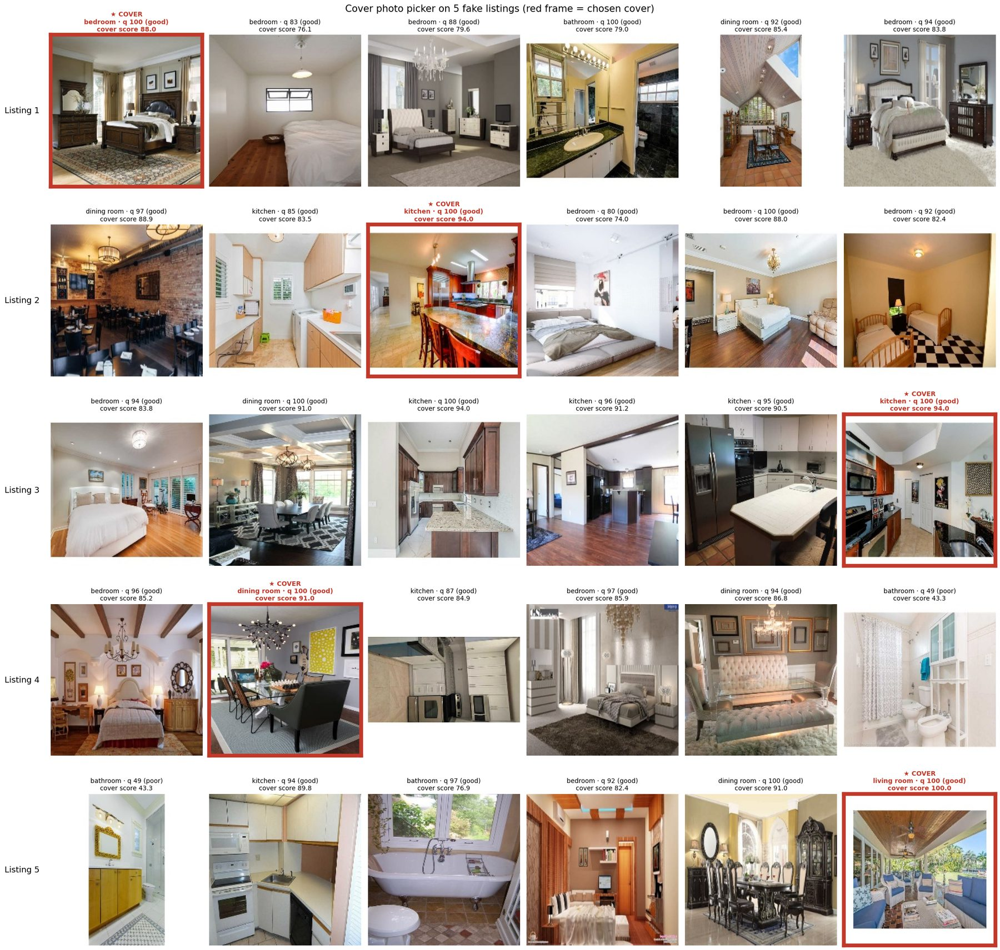
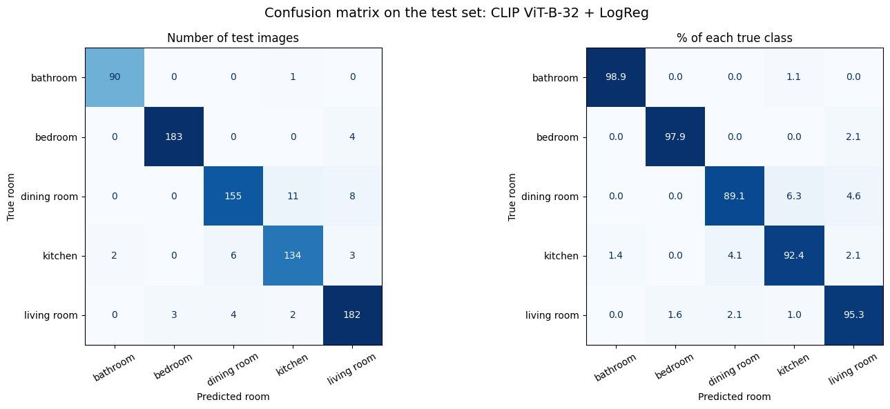
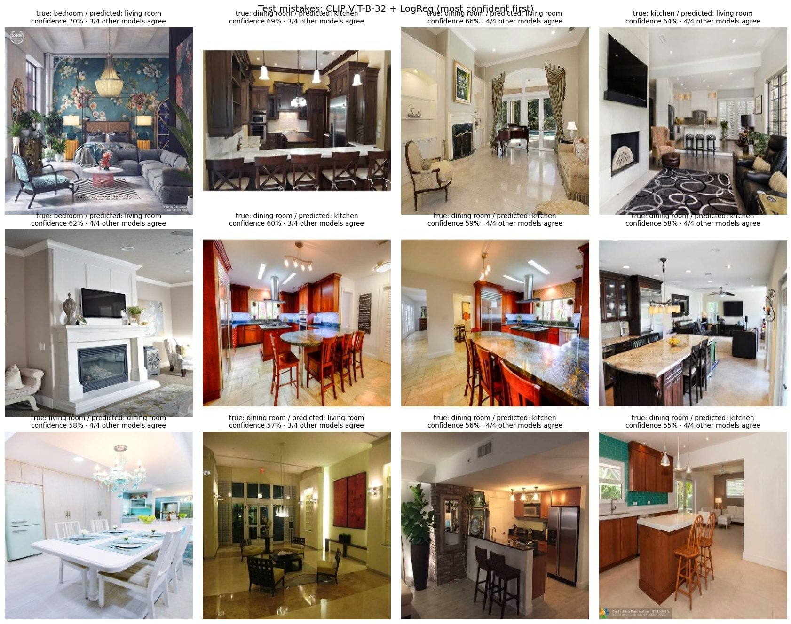
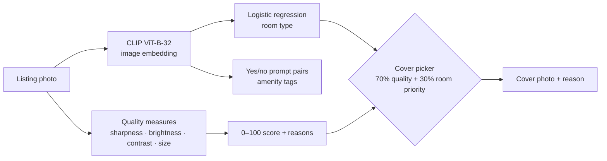
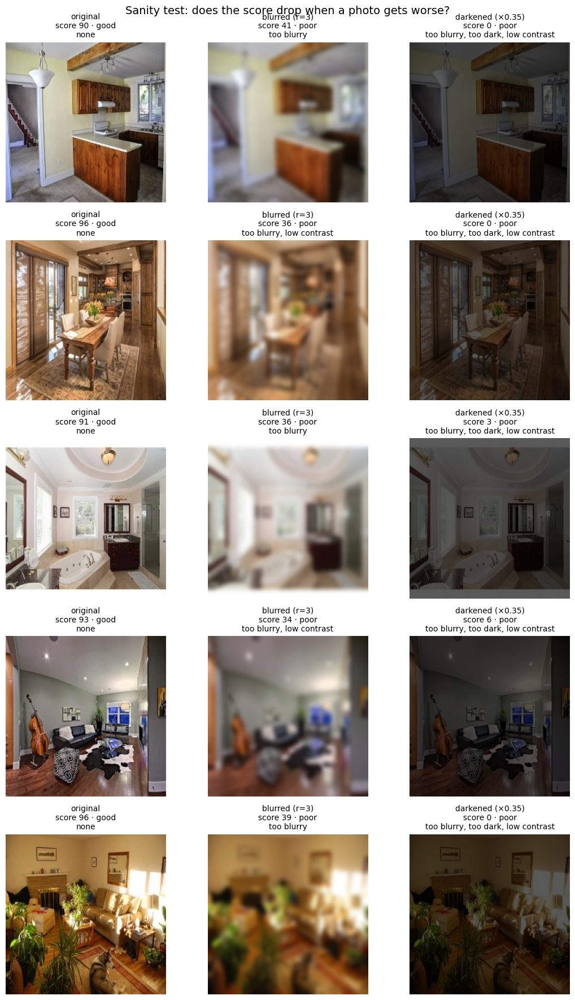
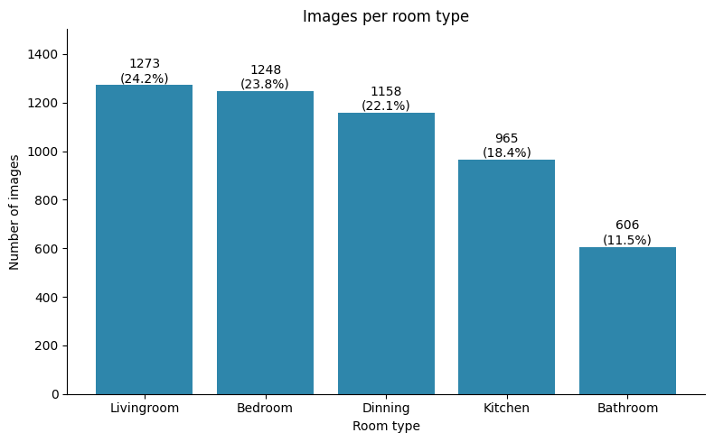
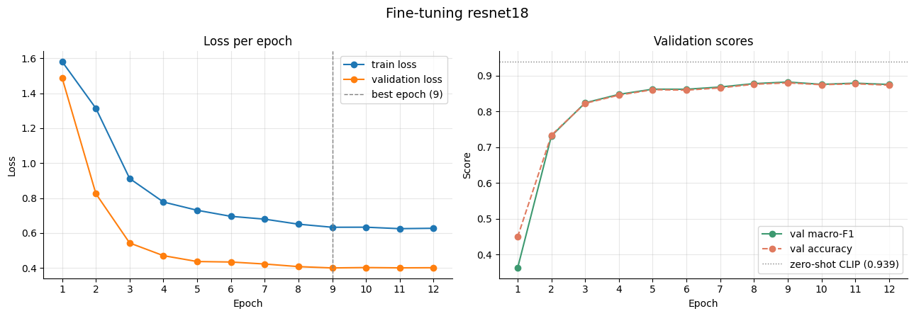

# ListingLens

**Room type, photo quality and amenity tags for real-estate listing photos, plus automatic cover selection.**

[](https://colab.research.google.com/github/elshahedmohamed1998-ux/listinglens/blob/main/notebooks/01_listinglens.ipynb)


Property marketplaces receive thousands of listing photos a day from developers and brokers, in every quality. Buyers judge a home by its photos, search filters need to know what each photo shows, and someone has to pick the photo that appears first. ListingLens does this automatically for every upload.


*Five fake listings of six photos each. Red frame = the cover ListingLens chose. Each photo shows its predicted room, quality score and cover score.*

---

## What it does

| Input | Output | How |
|---|---|---|
| One photo | **Room type**: bathroom, bedroom, dining room, kitchen, living room | CLIP ViT-B-32 embeddings + logistic regression |
| One photo | **Quality score** 0–100, grade and reasons ("too blurry", "too dark", …) | Laplacian sharpness, brightness, contrast, resolution |
| One photo | **Amenity tags**: pool, garden, balcony, sea view, open kitchen, large windows, air conditioning, unfinished walls | Zero-shot CLIP, a yes/no prompt pair per tag |
| All photos of a listing | **Cover photo** and a one-line reason | 70% quality + 30% room priority, never a "poor" photo |

---

## Results

Test set: 788 photos never used for any decision. Models were compared and chosen on a separate validation set.

| Model | Method | Test accuracy | Test macro-F1 | Training | Size |
|---|---|---:|---:|---|---:|
| SigLIP ViT-B-16 | zero-shot | 0.952 | 0.954 | none | 203M |
| CLIP ViT-L-14 | zero-shot | 0.949 | 0.951 | none | 428M |
| CLIP ViT-B-32 | zero-shot | 0.947 | 0.950 | none | 151M |
| **CLIP ViT-B-32 + logistic regression** ✅ | linear probe | **0.944** | **0.946** | **1.9 s** | 151M |
| ResNet-18 (ImageNet) | fine-tune, 12 epochs | 0.891 | 0.893 | 8.3 min | 11M |

✅ chosen on validation and used in the demo.

**What the numbers say**

1. **The four CLIP-style models are tied.** They are within 0.008 macro-F1, about 6 test images, and their order changed between validation and test. I kept the cheapest model chosen on validation rather than switching to the test-set leader, which would make the reported score optimistic.
2. **Pretraining beats fine-tuning on small data.** With ~3,700 training photos, a fine-tuned ResNet-18 stays ~5 points behind frozen CLIP. CLIP learned from billions of captioned web images, many of them homes; ImageNet is mostly single objects.
3. **Bigger isn't worth it here.** ViT-L-14 is 3× larger and encodes 12× fewer images per second than ViT-B-32 (17 vs 202 images/s on a T4) for less than one point of validation macro-F1.
4. **The data sets the ceiling.** Dining room is the hardest class (recall 0.891). Most errors are open-plan photos showing two rooms, and some photos appear in the dataset twice with different labels.

<p align="center">
  
</p>

<details>
<summary><b>Most confident mistakes</b>: most show two rooms at once</summary>



In 13 of the 44 test mistakes, all four other models predicted the same "wrong" class, a strong hint that the label itself is debatable. Fixes, from cheapest to best: show two rooms when the model is unsure (the demo does this), multi-label room tags, object detection first (sofa, dining table, oven…), and a re-labelling pass.
</details>

All tables are in [`results/`](results): [test results](results/test_results.csv), [every validation experiment](results/validation_experiments.csv), [per-class report](results/classification_report_test.csv), [C sweep](results/linear_probe_C_sweep.csv), [ResNet-18 training history](results/resnet18_history.csv), [tag frequencies](results/tag_frequency_test.csv).

---

## How it works



**Room type.** CLIP turns a photo into a 512-number vector. A logistic regression (C = 0.1, chosen on validation) trained on those vectors predicts the room. When the top two rooms are within 25 points, the app shows both ("living room / dining room"), because open-plan photos often really contain two rooms.

**Photo quality.** Each photo is resized to a 224-px short side, then measured: sharpness (variance of the Laplacian edge filter), brightness (mean grey level), contrast (grey-level spread) and original resolution. Each measure becomes a 0–100 sub-score that is exactly 50 at its threshold; the score is 55% sharpness + 30% brightness + 15% contrast, capped at 49 if any threshold fails. Blur counts most because it can't be fixed after the photo is taken.

<details>
<summary><b>Sanity test</b>: blurring or darkening a good photo must lower its score</summary>



Five photos that scored 90–96 fell to 34–41 when blurred and to 0–6 when darkened, all graded *poor* with the right main reason. One side effect: darkened photos were also called "too blurry", because darkening shrinks edge strength too. Next step: normalise contrast before measuring sharpness.
</details>

**Amenity tags.** Each tag is its own yes/no question: the photo is compared with "a room with a balcony" and "a room without a balcony" (two wordings each, averaged), and a softmax over the pair gives P(yes). No labelled data needed; a new tag is two new sentences. Tags were chosen for the Egyptian market: pools and gardens in compounds, sea views on the North Coast, core-and-shell (unfinished) units. Each tag has its own threshold (0.6–0.8) because some, like "large windows", fire on almost every bright room.

**Cover photo.** A business rule on top of the models: cover score = 70% quality + 30% room priority (living room 1.0 → bathroom 0.3). A *poor* photo is never chosen unless every photo is poor, in which case the app asks for better photos. On a real platform the weights would be tuned with an A/B test on clicks and leads.

---

## Data

[House Rooms Image Dataset](https://www.kaggle.com/datasets/robinreni/house-rooms-image-dataset) (Kaggle): 5,250 photos in 5 classes, downloaded at run time and not redistributed here. Split 70/15/15, stratified, seed 42.

What exploring the data found, and what was done about it:

| Finding | Consequence |
|---|---|
| Every image is exactly 224 × 224 RGB | The creator resized them; aspect ratios and fine detail are lost. Real uploads are larger and rarely square. |
| Class imbalance 2.1 : 1 (living room vs bathroom) | Stratified splits; macro-F1 as the main metric |
| At least one watermarked photo | Kept (real listings have watermarks) and flagged for error analysis |
| 41 of 788 validation photos (5.2%) have a near-copy in train | Checked: scores didn't inflate (0.945 → 0.949 without them). Some copies carry **different labels**, which caps living/dining accuracy. |

<p align="center">
  
  
</p>

---

## Run it

**The notebook** ([`notebooks/01_listinglens.ipynb`](notebooks/01_listinglens.ipynb)) runs top to bottom on a free Colab T4 GPU. It downloads the data with a Kaggle API key stored as Colab secrets (`KAGGLE_USERNAME`, `KAGGLE_KEY`) and saves every result to Google Drive.

**The demo app** runs on CPU:

```bash
cd app
pip install -r requirements.txt
python app.py
```

Copy `linear_probe_ViT-B-32.joblib` from your Drive results folder into `app/models/` to use the trained probe. Without it the app falls back to zero-shot CLIP (test macro-F1 0.950). To show example photos in the demo, put a few `.jpg` files in `app/examples/`.

**On Hugging Face Spaces:** create a Gradio Space and upload the contents of `app/` (including `config.json` and `models/`).

**Tests** for the quality score:

```bash
pip install pytest opencv-python-headless pillow numpy
python -m pytest tests
```

---

## Repository layout

```
listinglens/
├── README.md
├── LICENSE
├── notebooks/
│   └── 01_listinglens.ipynb     # full analysis, with outputs
├── app/
│   ├── app.py                   # Gradio UI: "Analyse a photo" and "Choose a cover"
│   ├── pipeline.py              # ListingLens class: CLIP, probe, tags, cover picker
│   ├── quality.py               # photo quality score (no deep learning)
│   ├── config.json              # every setting: prompts, thresholds, weights
│   ├── requirements.txt
│   └── models/                  # trained probe goes here (see models/README.md)
├── results/
│   ├── *.csv                    # all result tables
│   └── figures/                 # figures used in this README
└── tests/
    └── test_quality.py
```

---

## Limitations

- **Dataset gap.** Small, curated 224 × 224 photos of mostly Western homes. Egyptian listings (large phone photos, 3D renders of off-plan units, unfinished core-and-shell rooms) need their own labelled test set.
- **Five classes only.** No exterior, floor-plan, or "living + dining" class.
- **Tags are unmeasured.** Amenity tags were judged by eye; there are no tag labels to compute precision or recall.
- **Quality thresholds come from this dataset.** The sharpness measure reads plain, bright surfaces (white bathrooms) and dark photos as "blurry".

## Next steps

- Render-vs-real-photo detector: off-plan listings are mostly 3D renders.
- Multi-label room tags on a re-labelled subset.
- Contrast-normalised sharpness, compared with a learned quality model (MUSIQ).
- Permanent demo on Hugging Face Spaces.

## About this series

ListingLens is the first of five computer-vision projects for real-estate marketplaces, each built on public data with an honest evaluation and a runnable demo. Coming next: duplicate-listing and contact-leak detection, floor-plan parsing, construction progress from satellite imagery, and handover inspection.

## License

Code under the [MIT License](LICENSE). The dataset keeps its own license and is not redistributed here.

## Acknowledgements

Dataset by [robinreni](https://www.kaggle.com/datasets/robinreni/house-rooms-image-dataset) on Kaggle. Models from [OpenCLIP](https://github.com/mlfoundations/open_clip) (LAION-2B and WebLI weights) and [timm](https://github.com/huggingface/pytorch-image-models).
